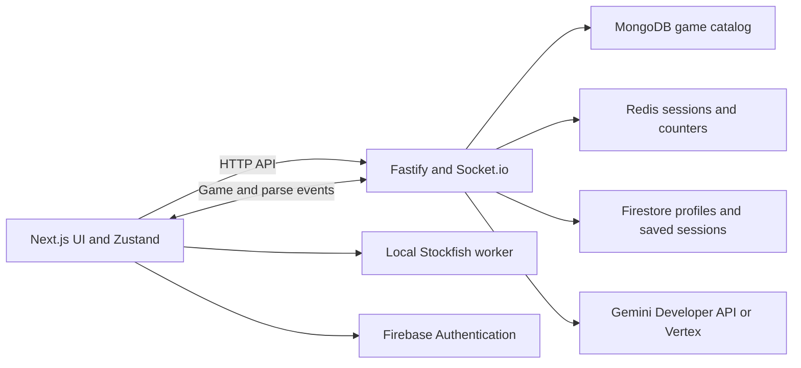

# Architecture and data storage

The repository is a two-package pnpm workspace. The frontend is Next.js 16 with
React 19, Tailwind 4, and Zustand 5. The backend is Fastify 5 with Socket.io.
[Configuration](CONFIGURATION.md) describes their environment boundaries;
[reliability](RELIABILITY.md) documents game correctness and recovery behavior.

## Runtime boundaries



The browser authenticates with Firebase and supplies ID tokens to the HTTP API
or socket handshake. Guests can use practice with a separate reconnect
credential. The server remains authoritative for historical practice,
multiplayer, and conversational AI games. The Stockfish bot and coordinate
trainer keep their game/exercise state in the browser.

Backend startup initializes cloud clients, connects to MongoDB, attempts Redis,
seeds the catalog if empty, and registers HTTP routes and socket handlers before
listening. `/health` reports server liveness; it does not continuously verify the
health of each database or AI provider.

## Frontend structure

| Location | Responsibility |
| --- | --- |
| [app](../frontend/src/app/) | Routes, layouts, providers, and page-level game flows. |
| [components](../frontend/src/components/) | Board, notation/voice input, authentication, practice statistics, and AI conversation UI. |
| [hooks](../frontend/src/hooks/) | Socket lifecycles, voice capture, config fetching, and engine lifecycle. |
| [stores](../frontend/src/stores/) | Practice, multiplayer, AI game, and install-prompt state. |
| [lib](../frontend/src/lib/) | Firebase, shared socket, move parsing, engine queue, and MDX loading. |
| [public/stockfish](../frontend/public/stockfish/) | Browser worker and engine assets served by Next.js. |
| [content/blog](../frontend/content/blog/) | MDX articles and frontmatter. |

The socket client is shared across mode hooks. Practice, multiplayer, and AI
handlers update their own Zustand stores. Selected preferences/session IDs are
persisted in browser storage; in-memory game boards are resynchronized from the
server where supported. The practice store separates persistent preferences
from per-tab session state.

## Backend structure

| Location | Responsibility |
| --- | --- |
| [index.ts](../backend/src/index.ts) | Startup, HTTP server, service connections, and shutdown signals. |
| [routes](../backend/src/routes/) | Authenticated profile/history/calibration HTTP endpoints and public config. |
| [socket](../backend/src/socket/) | Practice, multiplayer, and conversational AI event boundaries. |
| [middleware](../backend/src/middleware/) | Firebase socket authentication. |
| [services](../backend/src/services/) | Game rules, matchmaking, repositories, persistence, speech parsing, and AI calls. |
| [lib](../backend/src/lib/) | Cloud clients, ownership checks, request validation, timeouts, and game mutation queue. |
| [types](../backend/src/types/) | Event payloads and game/profile types. Frontend types live in its own package. |

`GameHandler` uses `PracticeService`; `MultiplayerHandler` uses matchmaking and
`MultiplayerService`; `AiGameHandler` uses `AiGameService`; conversation is independent of move selection.
Request boundaries validate payloads and catch async errors. Per-game mutation
queues coordinate multiplayer moves/clocks and practice/AI state mutations
inside one backend process. AI generation runs outside its game queue; snapshot
and commit stages serialize with moves, chat, and resignation. Practice saves
use one Firestore transaction for history and aggregate stats, checking the
session document before counting completion.

## Storage ownership

| Store | Data |
| --- | --- |
| MongoDB | Historical games and migration records. |
| Firestore `users/{uid}` | Profiles, aggregate practice stats, preferences, and voice calibration. |
| Firestore `users/{uid}/sessions` | Completed signed-in practice sessions and move summaries. |
| Firestore `users/{uid}/aiGames` | Completed AI games, including data used by review. |
| Firestore `appConfig/settings` | Public app configuration such as the Discord invite URL. |
| Redis | Active practice/multiplayer/AI session state, reconnect mappings, invites, and AI usage counters. |
| Browser storage | Input preferences, per-tab practice credentials/session ID, and trainer high score. |

When Redis is unavailable, process-local state is used; it does not survive a
backend restart. Do not treat Redis-backed sessions as a substitute for durable
Firestore history. The player lists are derived from the historical MongoDB
catalog; the catalog, imports, and seeds are retained. Retiring leagues, rewards,
and cosmetics requires no database migration. Existing legacy reward fields and
browser cosmetic keys remain stored but are no longer used. Session completion
updates aggregate `stats.*` fields without replacing the user's document.

Redis persistence is optional, but Firebase Admin initialization is required for
normal server startup. Multiple backend workers are not supported by the current
process-local rooms, timers, matchmaking, and multiplayer mutation queues.

## HTTP and socket interfaces

| HTTP endpoint | Access and purpose |
| --- | --- |
| `GET /health` | Public liveness response. |
| `GET /api/games` | Public historical catalog. |
| `GET /api/config` | Public app configuration. |
| `GET /api/user/profile` | Bearer token; profile, practice stats, and preferences. |
| `PUT /api/user/profile` | Bearer token; display-name update. |
| `GET /api/user/sessions` | Bearer token; recent practice summaries. |
| `GET /api/user/sessions/:sessionId` | Bearer token; one owned session's results. |
| `GET`, `PUT /api/user/voice-calibration` | Bearer token; speech calibration. |

Socket event families are declared in
[backend types](../backend/src/types/index.ts). Practice uses events such as
`start-practice`, `submit-practice-move`, and `resume-session`; multiplayer uses
`mp-*`; conversational games use `ai-*`, including `ai-parse-move` and
`ai-parse-audio`. All modes check session/game access before issuing AI calls.
Conversational AI parse requests include game ID, request ID, and position FEN;
`useAiMoveInput` clears pending work on a changed position/turn or disconnect.
The shared calibration cache lives with Firestore persistence and updates after
successful calibration saves; text-parse caches include user/revision keys.
The AI game page rejoins its room and reloads authoritative state on reconnect.

## Game catalog and content

[gameRepository.ts](../backend/src/services/gameRepository.ts) seeds five
historical games only when the MongoDB catalog is empty. Deploying Compose with
new volumes creates a new catalog; it does not copy a previous database. For
existing imports, follow the [catalog recovery procedure](DEPLOYMENT.md#recovering-an-existing-playergame-catalog)
to preserve game IDs and migration history.

For bulk imports, supply a PGN path accessible from the host and review a dry run
first. The importer does not load dotenv itself; this command explicitly loads
`backend/.env` from the filtered backend working directory:

```bash
pnpm --filter backend exec node --env-file=.env --import tsx src/scripts/importGames.ts --file /absolute/path/games.pgn --dry-run --limit 100
```

A dry run does not insert database records, but writes `reviewQueue.json` beside
the PGN file. Remove `--dry-run` to insert games into the configured MongoDB.
The opt-in `pnpm --filter backend migrate:01` command downloads famous-player
PGNs, inserts records, and tracks migration completion. Neither import command
runs as part of ordinary deployment or verification.

Blog content is read from `frontend/content/blog` and rendered with
`next-mdx-remote`. The optional frontend image includes this content, its static
files, and the PWA assets in addition to the standalone Next.js server.

[marketing/NARRATION_SCRIPT.md](marketing/NARRATION_SCRIPT.md) is input for
`scripts/generate-narration-audio.js`. That utility uses the ElevenLabs SDK and
`ELEVENLABS_API_KEY` from `backend/.env`; it is separate from speech input
and Gemini game chat.

## AI opponent decisions and review

`aiOpponentLlm.ts` requests one structured JSON decision with an enum of legal
SAN moves, a concise summary, legal alternatives, the opposing threat, and a
plan. `chess.js` remains authoritative for move legality and game endings. The
request includes the board, complete move history, the persona's playing style,
and the last three recorded plans. Player chat is excluded from move requests.
The model's default thinking configuration is preserved; the incompatible
`thinkingBudget: 0` setting is not sent.

`AiGameService` snapshots and commits under the per-game mutation queue while
provider calls run outside it. The move request has a 19-second deadline and at
most one retry within the overall 25-second generation/pacing budget. Each
attempt consumes a daily LLM allowance. Configuration/authentication errors and
timeouts skip the retry. The SDK request is aborted on deadline, automatic SDK
retries are disabled, and logs record model, error status, move source, generation
time, total turn time, and whether a summary exists. Prompts and summaries are
not logged.

The model response is validated again locally. Review explanations are stored
only for the move actually selected by a successful model response. A fallback
never inherits the explanation for a rejected move. Structured summaries are
optional in stored/review types so games saved before this change remain
readable. New turns also keep a formatted compatibility summary for older
frontends. Only the owning account can request a completed game's review; live
move and reconnect payloads exclude summaries and legacy thinking text.

Optional typed conversation uses separate bounded requests and the existing
per-game reply and flood limits. Messages received during a bot turn remain
queued; replies begin after the move event. Quiet games do not generate
conversation or farewells. A fallback status is stored independently of chat,
restored on reconnect, and cleared after an LLM recovery. Reconnecting also
restarts a bot turn interrupted by a backend restart, guarded against duplicate
live turns.
